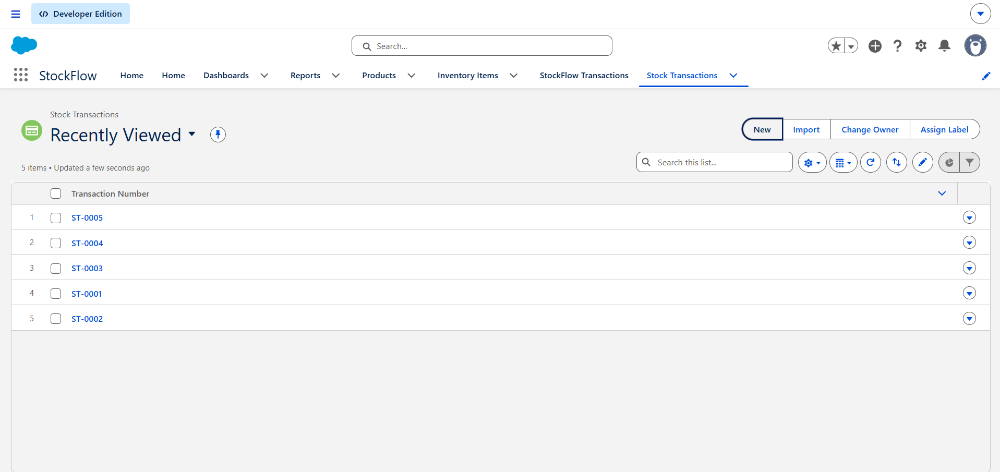
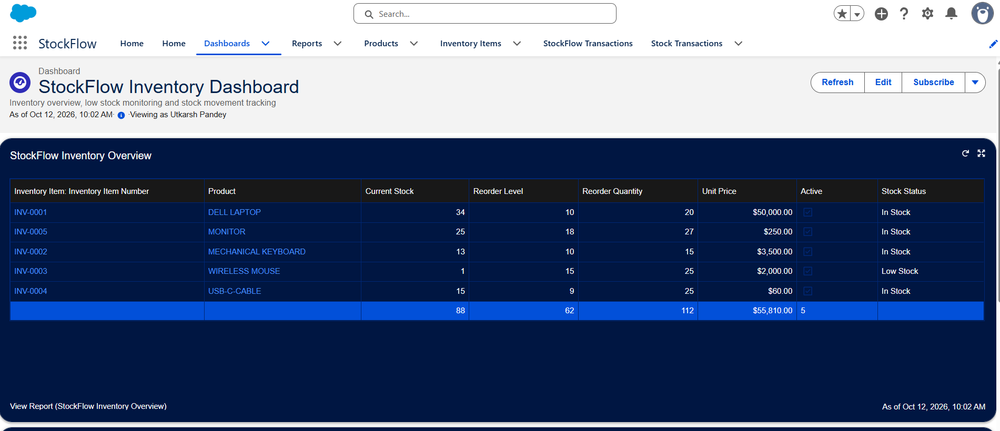
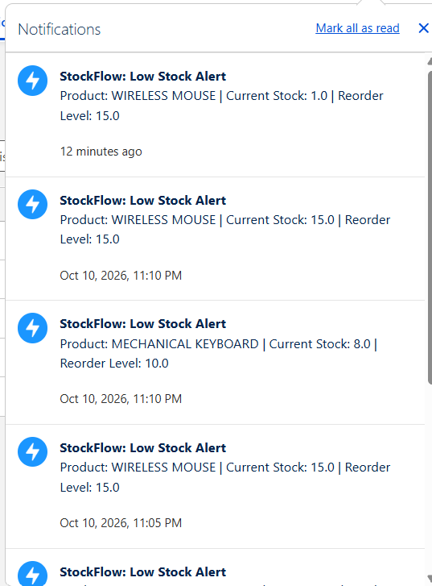
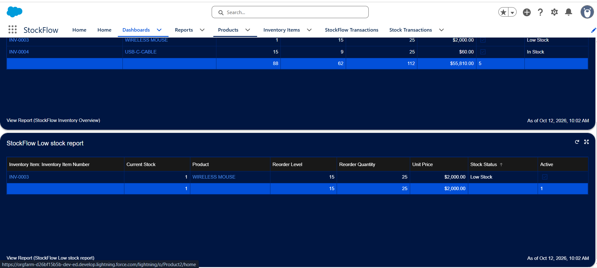

# StockFlow — Salesforce Inventory Management & Automated Reordering System

A Salesforce-based inventory management solution that helps businesses track stock levels, record stock movements, identify low-stock products, and automate inventory alerts using Apex, Platform Events, and Salesforce automation.

## Overview

**StockFlow** is a Salesforce project designed to simplify inventory monitoring and stock transaction management. It enables users to record stock-in and stock-out operations, maintain inventory quantities, detect low-stock items, and receive Salesforce notifications when inventory reaches its reorder threshold.

The project combines Salesforce data modeling, Apex programming, event-driven automation, batch processing, and reporting to demonstrate how Salesforce can support real-world business operations.

## Business Problem

Businesses need an effective way to monitor inventory and avoid stock discrepancies. Manual inventory tracking can lead to:

- Incorrect stock quantities.
- Insufficient stock during order fulfillment.
- Delayed identification of low-stock products.
- Lack of transaction history.
- Missed reorder alerts.
- Limited visibility into overall inventory health.

StockFlow addresses these problems by centralizing inventory records, validating stock movements, identifying low-stock items, and presenting inventory information through Salesforce reports and dashboards.

## Key Features

### 1. Inventory Management

- Maintain inventory records for different products.
- Track current stock, reorder levels, and reorder quantities.
- Store unit prices and supplier email addresses.
- Identify active inventory items.
- Associate inventory records with Salesforce products.

### 2. Stock In and Stock Out

Users can record inventory movements through a Salesforce Screen Flow.

**Stock In**
- Increases the available inventory quantity.
- Records the stock transaction.
- Updates the corresponding inventory record.

**Stock Out**
- Decreases the available inventory quantity.
- Validates stock availability before processing.
- Prevents transactions that would result in insufficient stock.

### 3. Transaction Validation

The Apex transaction handler validates stock movements before accepting them.

- Rejects stock-out transactions when the requested quantity exceeds available stock.
- Rejects zero or negative quantities.
- Prevents inventory quantities from being reduced below zero.
- Provides meaningful validation errors for invalid operations.

### 4. Automated Low-Stock Detection

StockFlow compares the current stock quantity against the configured reorder level.

An inventory item is classified as low stock when:

`Current Stock <= Reorder Level`

A Salesforce formula field, `Stock_Status__c`, classifies inventory records as **Low Stock** or **In Stock**.

### 5. Event-Driven Notifications

StockFlow uses Salesforce Platform Events to connect low-stock detection with notification delivery.

The notification workflow is:

1. The inventory batch process identifies low-stock items.
2. The batch publishes `Low_Stock_Event__e` Platform Events.
3. `LowStockEventTrigger` processes the published events.
4. `LowStockEventHandler` prepares Salesforce custom notifications.
5. The recipient can view the alert in the Salesforce notification interface.

The notification includes the product name, current stock quantity, and reorder level. The notification can also link to the relevant inventory record.

### 6. Scheduled Inventory Monitoring

A Schedulable Apex class launches the inventory batch process.

This supports periodic inventory monitoring without requiring a user to manually inspect every inventory record.

The scheduling configuration can be adjusted to match business requirements.

### 7. Reports and Dashboard

StockFlow includes inventory reporting components for operational visibility.

- **StockFlow Inventory Overview:** Displays inventory information.
- **StockFlow Low Stock Report:** Identifies records whose stock status is Low Stock.
- **StockFlow Inventory Dashboard:** Presents low-stock information through a dashboard component.

These components help users identify inventory risks and prioritize replenishment.

### 8. Automated Salesforce UI

A Salesforce Screen Flow provides a guided transaction-entry interface with:

- Inventory item selection.
- Transaction type selection.
- Quantity input.
- Automatic transaction date assignment.
- Success confirmation.
- Fault handling with an error message.

This reduces the need for users to create stock transaction records manually.

## Technology Stack

| Technology | Purpose |
|---|---|
| Salesforce Platform | Application platform and data management |
| Apex | Business logic and inventory validation |
| SOQL | Retrieving inventory records |
| Custom Objects | Storing inventory and transaction data |
| Lookup Relationships | Connecting inventory to Salesforce products |
| Salesforce Screen Flow | Guided stock transaction entry |
| Batch Apex | Processing inventory records for low-stock detection |
| Scheduled Apex | Initiating periodic inventory checks |
| Platform Events | Event-driven low-stock processing |
| Apex Triggers | Handling stock transactions and Platform Events |
| Custom Notifications | Alerting users about low-stock conditions |
| Formula Fields | Calculating inventory status |
| Salesforce Reports | Inventory and low-stock reporting |
| Salesforce Dashboards | Visual inventory monitoring |
| Salesforce CLI | Deploying metadata and executing Apex scripts |
| Visual Studio Code | Development and project management |
| Apex Test Classes | Validating business logic and regression scenarios |

## System Architecture

```text
Salesforce User
      |
      v
StockFlow Screen Flow
      |
      v
Stock Transaction Record
      |
      v
StockTransactionTrigger
      |
      v
StockTransactionHandler
      |
      v
Inventory Quantity Updated
      |
      v
InventoryStockCheckBatch
      |
      v
Low_Stock_Event__e
      |
      v
LowStockEventTrigger
      |
      v
LowStockEventHandler
      |
      v
Salesforce Custom Notification

Inventory Records
      |
      v
Salesforce Reports
      |
      v
StockFlow Inventory Dashboard
```

## Salesforce Data Model

### 1. Inventory Item — `Inventory_Item__c`

Stores inventory information for each managed product.

| Field | Type | Description |
|---|---|---|
| `Name` | Auto Number | Unique inventory record identifier |
| `Product__c` | Lookup to Product | Associated Salesforce product |
| `Current_Stock__c` | Number | Available inventory quantity |
| `Reorder_Level__c` | Number | Threshold for low-stock identification |
| `Reorder_Quantity__c` | Number | Suggested quantity for replenishment |
| `Unit_Price__c` | Currency | Unit price of the item |
| `Supplier_Email__c` | Email | Supplier contact email |
| `Active__c` | Checkbox | Indicates whether the inventory item is active |
| `Stock_Status__c` | Formula (Text) | Indicates Low Stock or In Stock |

### 2. Stock Transaction — `Stock_Transaction__c`

Stores individual stock movement records.

| Field | Type | Description |
|---|---|---|
| `Name` | Auto Number | Unique transaction identifier |
| `Inventory_Item__c` | Lookup | Associated inventory item |
| `Transaction_Type__c` | Picklist | Stock In or Stock Out |
| `Quantity__c` | Number | Quantity involved in the transaction |
| `Transaction_Date__c` | Date | Date of the transaction |

### 3. Low Stock Platform Event — `Low_Stock_Event__e`

Carries low-stock information from the batch process to the event trigger.

| Field | Type | Description |
|---|---|---|
| `Inventory_Item_ID__c` | Text | Inventory record ID |
| `Product_Name__c` | Text | Product name |
| `Current_Stock__c` | Number | Current stock quantity |
| `Reorder_Level__c` | Number | Configured reorder threshold |

## Apex Components

The principal Apex components include:

| Component | Responsibility |
|---|---|
| `InventoryService` | Retrieves and filters low-stock inventory items |
| `StockTransactionHandler` | Validates stock transactions and updates inventory quantities |
| `StockTransactionTrigger` | Invokes transaction handling before transaction insertion |
| `InventoryStockCheckBatch` | Identifies low-stock inventory and publishes Platform Events |
| `InventoryStockCheckScheduler` | Schedules execution of the batch process |
| `LowStockEventTrigger` | Handles newly published low-stock events |
| `LowStockEventHandler` | Sends Salesforce custom notifications |
| `InventoryServiceTest` | Tests inventory service logic |
| `InventoryStockCheckBatchTest` | Tests batch execution |
| `InventoryStockCheckSchedulerTest` | Tests scheduled execution |
| `StockTransactionHandlerTest` | Tests stock-in, stock-out, and insufficient-stock scenarios |

## Validation and Testing

The following scenarios were manually verified during development.

| Test Scenario | Expected Result | Status |
|---|---|---|
| Stock In | Inventory quantity increases | Passed |
| Stock Out | Inventory quantity decreases | Passed |
| Insufficient Stock | Invalid stock-out is rejected | Passed |
| Zero Quantity | Transaction is rejected | Passed |
| Negative Quantity | Transaction is rejected | Passed |
| Transaction History | Stock transaction is recorded | Passed |
| Low-Stock Detection | Eligible low-stock records are identified | Passed |
| Low-Stock Notification | Notification appears in Salesforce | Passed |
| Dashboard | Low-stock information is displayed | Passed |

Apex test classes were also executed for the inventory service, batch process, scheduler, and stock transaction handler.

**Testing note:** The table above represents development verification. Add test execution screenshots and final automated test results to the repository before presenting the project as production-ready.

## Project Setup

### Prerequisites

Before working with StockFlow, install or configure:

- A Salesforce Developer Edition org or another authorized Salesforce development org.
- Visual Studio Code.
- Salesforce CLI.
- Salesforce Extension Pack for Visual Studio Code.
- Git.

### 1. Clone the Repository

Replace the example URL with the actual repository URL after publishing the project.

```bash
git clone https://github.com/YOUR_USERNAME/StockFlow.git
cd StockFlow
```

### 2. Authorize a Salesforce Org

```bash
sf org login web --alias devOrg
```

Complete the login flow in the browser and authorize the development org.

### 3. Deploy Salesforce Metadata

From the project root, deploy the Salesforce source to the authorized org.

```bash
sf project deploy start --target-org devOrg
```

Review deployment output and resolve any metadata or configuration errors.

### 4. Run Apex Tests

Run the relevant test classes:

```bash
sf apex run test --tests InventoryServiceTest --target-org devOrg --wait 10
sf apex run test --tests InventoryStockCheckBatchTest --target-org devOrg --wait 10
sf apex run test --tests InventoryStockCheckSchedulerTest --target-org devOrg --wait 10
sf apex run test --tests StockTransactionHandlerTest --target-org devOrg --wait 10
```

Review the test results and coverage reported by Salesforce.

### 5. Run the Inventory Batch

If the repository contains `scripts/apex/runInventoryBatch.apex`, execute:

```bash
sf apex run --file scripts/apex/runInventoryBatch.apex --target-org devOrg
```

The batch processes eligible inventory items and publishes low-stock events. A notification is expected only when eligible low-stock items exist and the notification configuration and recipient are valid.

### 6. Configure Notifications

Confirm that the target org contains:

- The `Low_Stock_Event__e` Platform Event and its fields.
- The `LowStockEventTrigger` and `LowStockEventHandler`.
- The `StockFlow_Low_Stock_Alert` custom notification type.
- A valid notification recipient.
- Appropriate user permissions and notification settings.

### 7. Configure the Screen Flow and Dashboard

After deploying the relevant metadata, verify that the StockFlow transaction Screen Flow, inventory reports, and dashboard are available and active. If any component was created manually in Setup rather than included in the source repository, recreate or configure it in the target org.

## Repository Structure

The intended Salesforce DX project structure is shown below. The exact files and folders should match the contents committed to the repository.

```text
StockFlow/
├── force-app/
│   └── main/
│       └── default/
│           ├── classes/
│           ├── triggers/
│           ├── objects/
│           ├── flows/
│           ├── reports/
│           ├── dashboards/
│           └── ...
├── scripts/
│   └── apex/
│       ├── runInventoryBatch.apex
│       ├── scheduleStockFlow.apex
│       ├── testLowStockEvent.apex
│       └── testNotification.apex
├── .gitignore
├── sfdx-project.json
└── README.md
```

This is an illustrative structure, not a claim that every listed metadata directory or script is already present. Include only files that actually exist in the repository.

## Screenshots

Add screenshots of the running application to a `screenshots/` directory and update the image paths below.

### Inventory Transaction Screen



### Inventory Dashboard



### Low-Stock Notification



### Low-Stock Report



## Security and Deployment Notes

- Do not commit Salesforce passwords, access tokens, session IDs, private keys, or other credentials.
- Do not publish private customer or business data.
- Review Apex sharing and access controls before using the application with real business data.
- Validate notification recipients rather than relying on a hardcoded user ID.
- Test the application in a development or sandbox org before deploying it to production.
- Review error handling, transaction consistency, and bulk-processing behavior before production use.
- Confirm that all required Flow, report, dashboard, custom object, and custom notification metadata is included or documented for manual setup.

## Future Enhancements

Potential future improvements include:

- Automated purchase order generation.
- Supplier email alerts for reorder conditions.
- Configurable reorder rules.
- Inventory movement audit reports.
- Role-based inventory access.
- Advanced dashboard charts and KPIs.
- Improved bulk-processing and concurrency handling.
- Additional automated tests for edge cases and failure scenarios.

## Skills Demonstrated

This project demonstrates practical experience with:

- Salesforce data modeling and relationships.
- Apex classes, triggers, and exception handling.
- SOQL and Salesforce record processing.
- Batch Apex and Scheduled Apex.
- Platform Events and event-driven architecture.
- Salesforce Screen Flow.
- Custom notifications.
- Reports and dashboards.
- Apex unit testing.
- Salesforce CLI and metadata deployment.

## Author

**Utkarsh Pandey**

BCA Graduate | Aspiring Salesforce Developer


*StockFlow is a portfolio project developed for learning and demonstrating Salesforce development concepts. Production use requires additional security review, testing, and operational configuration.*
